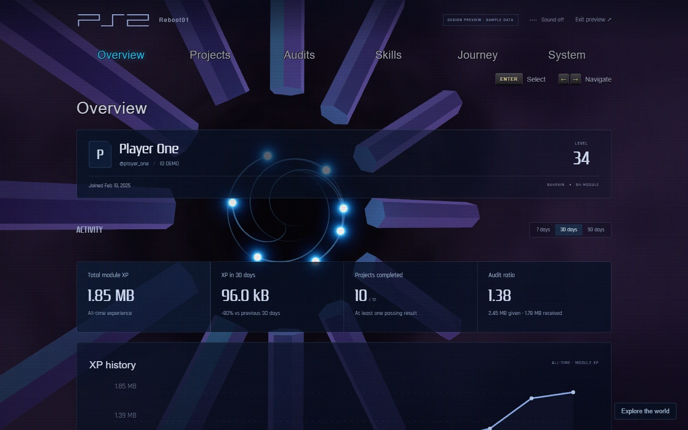
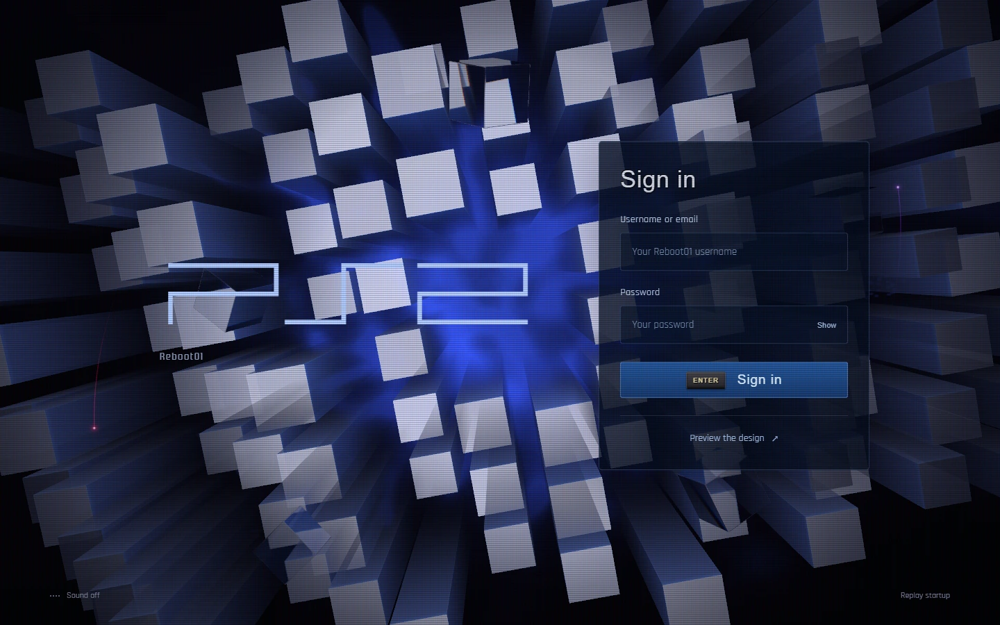
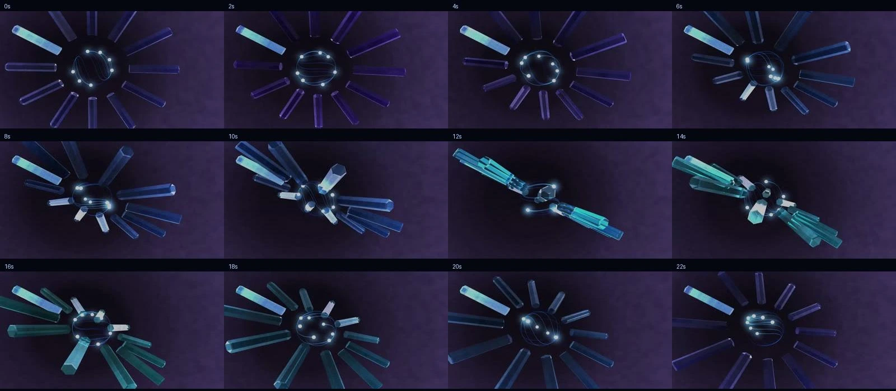
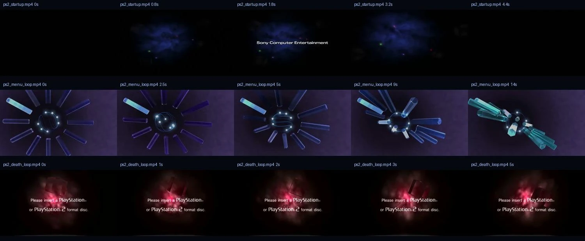
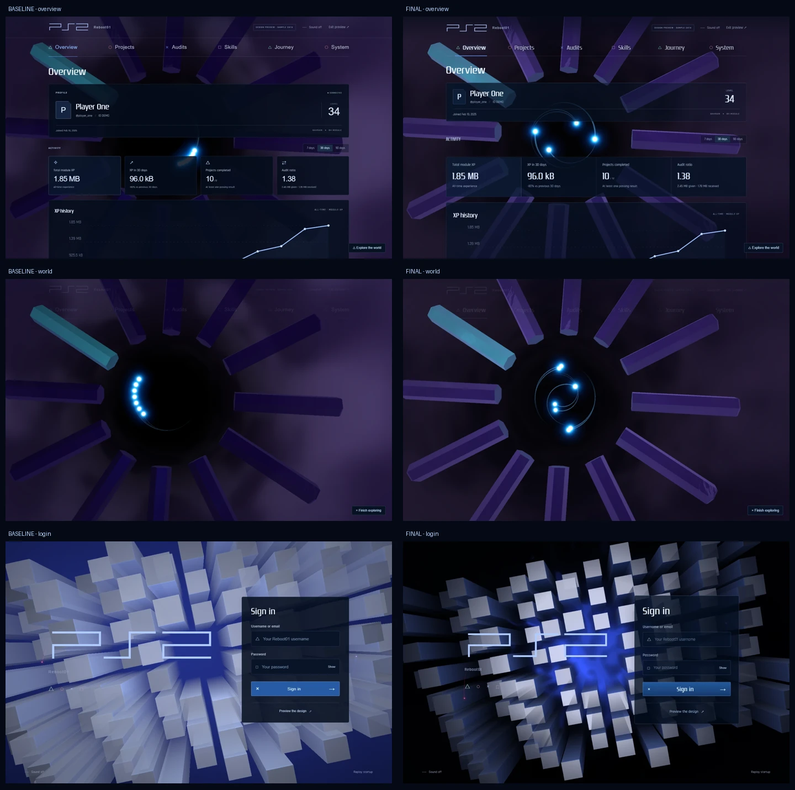
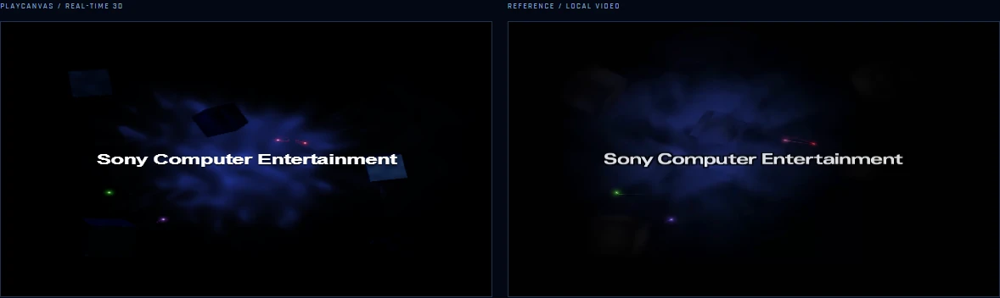

# Current menu and optical pass

The following screenshots supersede the earlier static-crystal pass below. Live 3D remains the default.

The menu labels and key headings now use a Helvetica-style face with grey inactive text and cyan hover/selection, following the inspected imsaud.me screens. Fine scanlines and a subtle RGB mask are static overlays; they do not lower the 3D render resolution. Keyboard keycaps replace repeated controller symbols. The reference site's selection, confirmation and cube-selection sounds are integrated with the existing volume/mute controls.

The low desktop geometry quality was caused by the previous 1.25 MP canvas cap. The current standard mode preserves native desktop pixels with up to 2x DPR and an 8.3 MP ceiling, plus four-sample antialiasing. A 2048x1210 check confirms the exact canvas dimensions and no blur filter. [Native desktop screenshot](visual-review/login-native-2048.webp).

The login camera is closer (37 units), with five slowly floating clear cubes. Startup/login glass transmits the actual fog, pillars and colored lasers, with restrained body tint and Fresnel highlights. The startup lasers now travel at different world depths, and ribbons retain historical world positions. Corrected red/pink tracks pass through each other in projection without bouncing or colliding in 3D.

The crystal ring rotates through depth and briefly accelerates on tab changes. The integral of each burst retains the current angle. A measured browser sample turned about 3 degrees in 400 ms normally, about 16 degrees over the 500 ms tab pulse, then about 3 degrees in the next 400 ms. All crystals share one material; cyan comes from changing world lighting and blue orbital reflections rather than an index-based color.

Logout was checked with an authenticated dummy account and a repeated click: the route/authentication stays intact during the inward move, commits once at a fully black curtain, then reveals the pillars outward. Browser checks also cover the six menus, project opening/Backspace close, startup sound, red failure/retry, motion pause, native desktop resolution and 390px mobile widths. **32 unit tests and the production build pass.**

[Current world](visual-review/menu-current-world.webp) ? [Project details](visual-review/project-detail-current.webp) ? [Startup comparison](visual-review/startup-current.webp) ? [Mobile overview](visual-review/menu-mobile-overview.webp)

---

# PS2 visual review

Live 3D is the default. The optional asset background remains available in System. This pass retains startup, sound, the login pillar field, camera arrival/departure, the crystal world, continuous purple smoke and directional smoke navigation.

## Reference check

The startup, crystal menu and death-loop videos were sampled at several times before the changes. The supplied pillar screenshot guided concentrated central light, bright square caps and near-black recessed shafts. The original OBJ proportions and fixed crystal pose remain intact.

## Before and after

The baseline had an oversized profile, a hard fog opening, nearly unlit crystal faces and a uniformly bright pillar field. The new interface uses compact PS2 typography, a shared statistics strip, thin navy surfaces and open space around the clock. Audits have an opaque backing for their values. Projects show the library before progression history. There are no optical UI filters or bubble-shaped navigation controls.

The pillar camera settles farther out, making the caps smaller and exposing the full field. The cap material responds to concentrated blue-white light; long shafts fade into darkness. Smoke retains the local texture's curls in both its density and lighting. Startup exposure is calibrated separately from login.

Crystal normals, lights and view direction now use a consistent world-space basis. Glass uses tinted transmission, HDR reflections, restrained surface detail and darker end caps. The seven orbiting lights keep visible fading trails.

Full-size views: [overview](visual-review/final-overview.webp), [crystal world](visual-review/final-world.webp), [login](visual-review/final-login.webp).

## Startup comparison

Geometry and paths remain a reconstruction. Cloud shapes and glass response are authored approximations; this is not pixel-identical BIOS emulation. The comparison route at `/preview/startup` allows further inspection.

## Performance changes and checks

- The 108 static pillars now share one mesh/material submission, retaining per-pillar face colors and depth gradients in vertex attributes.
- Main light trails evaluate their orbits on the GPU using static ribbon buffers. They no longer rebuild vertex positions and upload buffers each frame.
- Hidden cubes and pillar materials stop doing unnecessary updates. Scene-color capture runs only while startup/death glass requires it, including the retry fade.
- Dark gradients use a packed floating-point target where supported, with RGBA16F fallback. Two-sample anti-aliasing improves geometry edges.
- One canvas persists through route changes. Settled animation is capped at 30 fps; transitions and exploration request up to 60. Hidden tabs stop rendering; motion pause was verified.

A warm 1440×900 Direct3D11 test on the available RTX 2080 sampled 80 rendered frames over 3.004 seconds (26.6 fps, 30 fps ambient cap). Browser main-thread task duration was 0.103 seconds during that interval. This does not measure whole-machine CPU utilization or guarantee another device's frame rate. Software-rendered screenshots were much slower and were used for comparison, not hardware performance claims.

All six menus were checked at 390 px without document overflow. The review caught and corrected a long date overflowing Journey's metrics. Startup pillar visibility, login sound, red failure/retry, successful login, persistent canvas, project search/dialogs, motion pause and directional smoke continuity were checked in the browser. The production build and 25 unit tests pass. Live account checks used intercepted dummy responses; no real school credentials were used.

Mobile screenshots: [overview](visual-review/mobile-overview.webp), [projects](visual-review/mobile-projects.webp), [audits](visual-review/mobile-audits.webp), [skills](visual-review/mobile-skills.webp), [journey](visual-review/mobile-journey.webp), [system](visual-review/mobile-system.webp).

The user's [UI resource collection](https://github.com/maxbogo/awesome-ai-tools-for-ui#skills) led to [frontend-design](https://github.com/anthropics/skills/tree/main/skills/frontend-design) and [rendering-performance](https://github.com/CloudAI-X/threejs-skills/tree/main/skills/threejs-performance) guidance. Hierarchy, reference review, profiling, batching and allocation guidance were applied to the existing PlayCanvas implementation.
